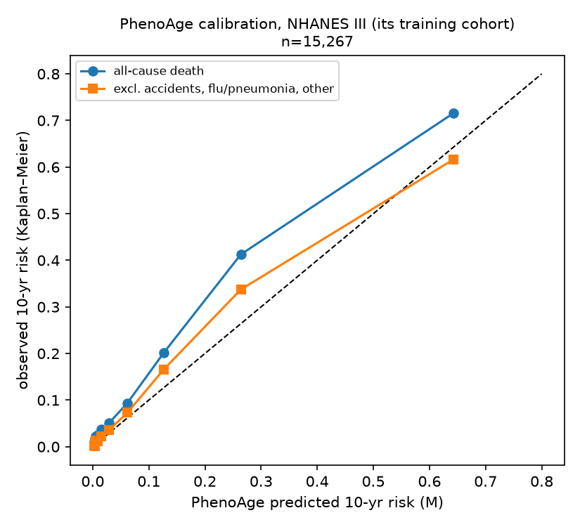
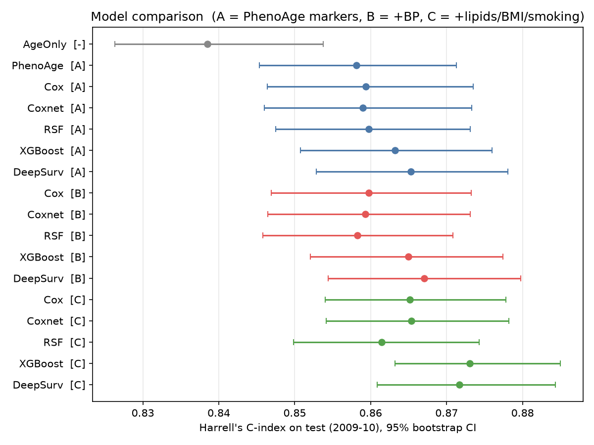
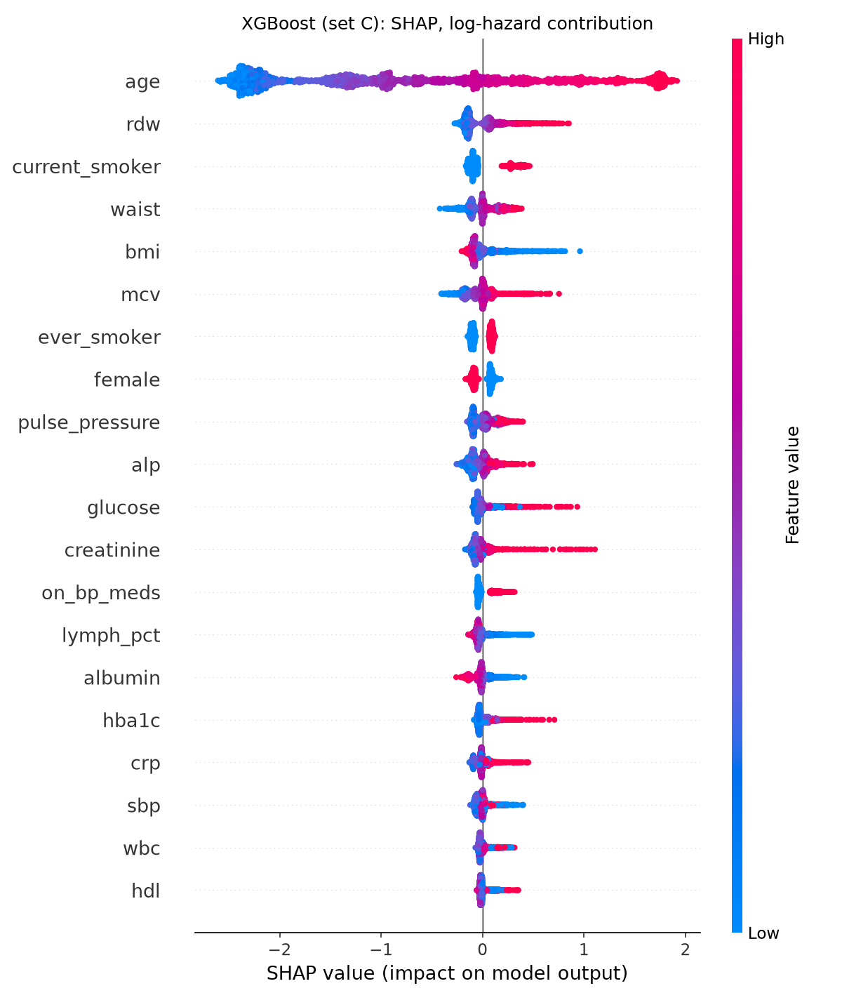
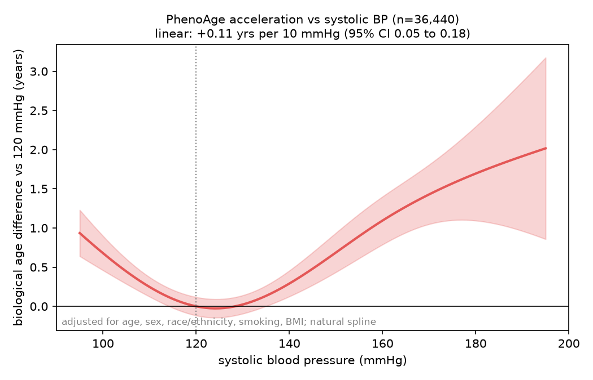
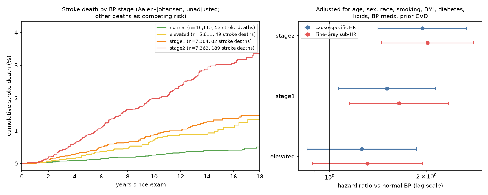
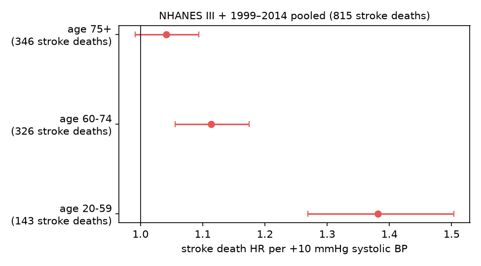
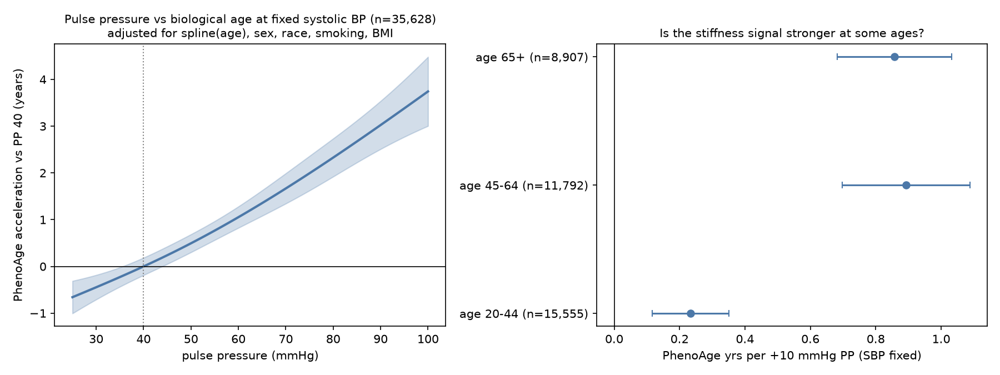
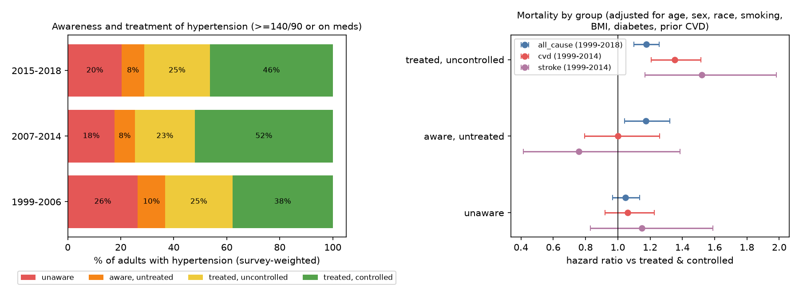
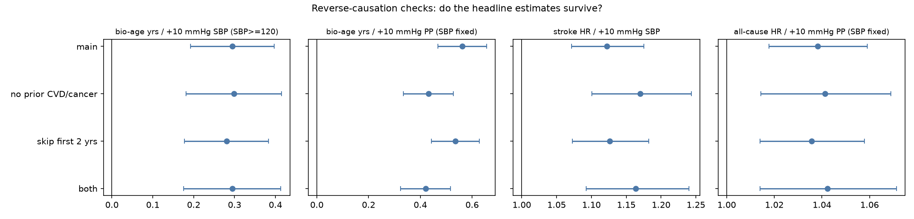
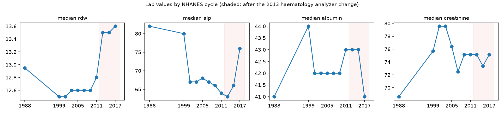

# Results — v2

Nov 23, 2026 · NHANES III (1988–94) + NHANES 1999–2018, linked to deaths through 31 Dec 2019 · reproducible with `../README.md`

All findings are **associations in population data**, not causal effects or individual advice.

## What changed since v1

| Gap from v1 | Status |
| --- | --- |
| PhenoAge under-predicts risk: why? | **Solved.** It predicts *aging-related* deaths, not all deaths (§2). Also fixed a mistyped constant. |
| Reverse-causation sensitivity | **Done.** Every headline result survives (§4.5). |
| Pulse pressure × age, non-linear PP | **Done.** The signal is 4× stronger from age 45 on (§4.3). |
| NHANES III | **Added.** 16,520 adults, 26 years of follow-up, PhenoAge's own training cohort (§3, §4.2). |
| Fine–Gray robust CIs | **Done** with a custom fitter (0.7 s vs >9 min; matches lifelines exactly). |
| Lab assay drift between cycles | **New finding.** Creatinine recalibrated; RDW jumps after 2013 (§5). |
| FastAPI route | **Done:** `bioage.api` router plus `predict.py` (§6). |
| Exploration notebook | **Done:** `notebooks/01_explore.ipynb`. |

## TL;DR

1. **Our best model (XGBoost, feature set C) beats the published PhenoAge on every test**, including PhenoAge's own 1988–94 training cohort: C-index 0.864 vs 0.852 (age alone: 0.836). On the 2009–10 test set it's 0.873 vs 0.858.
2. **PhenoAge's "under-prediction" is by design.** It was trained on aging-related mortality. Its predicted 10-year risk (0.110) matches observed deaths excluding accidents, flu/pneumonia and "other" causes (0.109), not all deaths (0.150).
3. **Each +10 mmHg systolic (above 120):** **+0.3 years of biological age**, replicated in NHANES III (+0.38).
4. **Stroke, now with 815 stroke deaths:** HR **1.11 per 10 mmHg** overall. **1.38 under age 60**, matching the landmark Lewington 2002 estimate (~1.41). It fades to 1.04 at 75+.
5. **Pulse pressure (arterial stiffness) is the strongest BP-aging link:**
   - **+0.56 years of biological age per 10 mmHg at fixed systolic**, replicated in NHANES III (+0.56);
   - **~0.9 years per 10 mmHg from age 45 on**, versus 0.23 under 45;
   - it still does **not** predict stroke beyond systolic pressure.
6. **Watch the lab analyzer:** a 2013 RDW shift makes 2015–18 participants look about 3 years "older" on PhenoAge. Rankings are unaffected; absolute biological ages are.

## 1. Data

| Cohort | Adults | Deaths | Stroke deaths | Median follow-up | Role |
| --- | --- | --- | --- | --- | --- |
| NHANES III 1988–94 | 16,520 | 7,082 | 472 | 26.2 yrs | backward validation, pooled stroke |
| 1999–2006 | 20,290 | 5,699 | 339 | 14–20 yrs | train |
| 2007–08 | 5,926 | 1,123 | 69 | 11.8 yrs | validation |
| 2009–10 | 6,201 | 859 | 50 | 9.8 yrs | test (opened once) |
| 2011–14 | 11,303 | 1,093 | 60 | 6–8 yrs | no CRP; stroke analyses only |
| 2015–18 | 11,225 | 419 | n/a* | 2–4 yrs | external check |

\* The 2015–18 public files code only heart disease, cancer and "other", so stroke analyses use 1988–2014.

## 2. Why PhenoAge under-predicts (solved)

PhenoAge's mortality score M comes from a Gompertz model trained on NHANES III. Comparing M with observed 10-year mortality:

| Cohort | Mean predicted M | Observed, all causes | Observed, excl. accidents, flu/pneumonia, other |
| --- | --- | --- | --- |
| NHANES III (training cohort) | 0.116 | 0.159 | **0.122** |
| NHANES 1999–2006 | 0.110 | 0.150 | **0.109** |

So M is the risk of an *aging-related* death. The BioAge R package uses the same outcome definition. Things that were checked and ruled out: the creatinine assay (changes M from 0.110 to 0.111) and `ln(1+CRP)` instead of `ln(CRP)` (makes it worse).

**Bug fixed along the way.** My PhenoAge used 0.09165 as the final denominator; the correct value is 0.090165. That shifted PhenoAge values by about 1.5 years. Rankings, C-indices and hazard ratios were unaffected. Constants now come verbatim from BioAge, and a test pins them. PhenoAge correlates 0.936 with age in NHANES III (paper: 0.94). It comes out 3–5 years below chronological age even in its own training cohort, so that offset is a property of the formula, not of our data.

## 3. Model comparison

Train 1999–2006 → choose settings on 2007–08 → report on 2009–10 (9-year horizon) → check on 2015–18 and, new, **backwards on 1988–94**.

| Model | Features | Test C (95% CI) | AUC 9 yr | Int. Brier ↓ | 2015–18 C | **1988–94 C (20 yr)** |
| --- | --- | --- | --- | --- | --- | --- |
| Age only | age | 0.838 (0.826–0.854) | 0.859 | 0.045 | 0.825 | 0.836 |
| PhenoAge (published) | A | 0.858 (0.845–0.871) | 0.877 | 0.045 | 0.860 | 0.852 |
| Cox | C | 0.865 (0.854–0.878) | 0.885 | 0.041 | 0.874 | — |
| Random survival forest | C | 0.861 | 0.881 | 0.043 | 0.859 | — |
| **XGBoost-Cox** | **C** | **0.873 (0.863–0.885)** | **0.891** | **0.040** | **0.879** | **0.864** |
| DeepSurv | C | 0.872 (0.861–0.884) | 0.891 | 0.041 | 0.877 | — |
| XGBoost-Cox | A | 0.863 | 0.882 | 0.041 | 0.871 | — |
| XGBoost-Cox | B | 0.865 | 0.884 | 0.041 | 0.871 | — |

The full table of 17 runs is in `model_results.csv`.

- **Backward validation is the strongest evidence yet.** XGBoost-C was trained on 1999–2006 people and still beats PhenoAge on the 1988–94 cohort PhenoAge was fitted to. Its biological age keeps predicting there too: HR 1.44 per +5 years of acceleration (1.41–1.46).
- **Adding BP (A → B) barely changes prediction of *death*** (+0.001–0.002). Adding lifestyle factors (B → C) helps, by about +0.008.
- **XGBoost and DeepSurv are tied.** Plain Cox on set C is close behind; all CIs overlap.
- **Calibration:** XGBoost and DeepSurv sit on the diagonal (`figures/calibration.png`). PhenoAge sits below it for the reason in §2.
- **Biological age (XGBoost-C):** acceleration SD 8.2 years; each +1 SD gives HR 2.03 for death after adjusting for real age.

## 4. Blood pressure deep-dive

### 4.1 Systolic BP vs biological age

PhenoAge acceleration, adjusted for age, sex, race/ethnicity, smoking and BMI. 1999–2010 + 2015–18, n = 36,440.

| | Years per +10 mmHg SBP |
| --- | --- |
| **SBP ≥ 120** | **+0.31 (0.21–0.41)** |
| NHANES III, SBP ≥ 120 (independent cohort) | +0.38 (0.25–0.51) |
| All SBP, linear | +0.11 (0.05–0.18) |
| SBP < 120 | −0.62 (−0.81 to −0.44): low BP looks *older* (frailty, illness) |
| ML biological age (DeepSurv-A, no BP input, out-of-sample) | +0.19 (0.13–0.25) |
| Also adjusted for BP meds | +0.05 (−0.01 to 0.12) |

The curve is U-shaped with its lowest point around 120–130 mmHg. Above that, about 0.3 years per 10 mmHg. Treat the left arm as reverse causation, not as "low BP ages you".

### 4.2 Stroke, with competing risks

Adjusted for age, sex, race, smoking, BMI, diabetes, cholesterol, HDL, BP meds and prior CVD (plus a survey-era indicator when pooled).

| Per +10 mmHg SBP | 1999–2014 (373 stroke deaths) | **+ NHANES III (815 stroke deaths)** |
| --- | --- | --- |
| Cause-specific HR | 1.12 (1.07–1.17) | **1.11 (1.08–1.15)** |
| Fine–Gray sub-HR (robust CI) | 1.11 (1.06–1.16) | 1.09 (1.05–1.13) |
| Age 20–59 | 1.34 (1.17–1.54) | **1.38 (1.27–1.50)** |
| Age 60–74 | — | 1.11 (1.06–1.18) |
| Age 75+ | — | 1.04 (0.99–1.09) |
| Stage 2 (≥140/90) vs normal | 1.94 (1.41–2.67) | 1.87 (1.49–2.34) |
| Stage 1 vs normal | 1.51 (1.06–2.14) | 1.35 (1.06–1.73) |

Lewington 2002 reports about 2× stroke mortality per 20 mmHg in middle age (≈ 1.41 per 10 mmHg). Our under-60 estimate of 1.38 sits right on it. The weaker effect at older ages is expected: BP's *relative* importance falls with age, and a single exam's BP is noisy (regression dilution).

### 4.3 Pulse pressure, the arterial-stiffness signal

| Per +10 mmHg pulse pressure, SBP held fixed | Estimate |
| --- | --- |
| Stroke death HR (pooled, 815 deaths) | 0.96 (0.90–1.02): **no extra stroke signal** |
| All-cause death HR (pooled) | 1.035 (1.02–1.05) |
| **Biological age, 1999–2018** (spline age adjustment) | **+0.57 yrs (0.48–0.66)** |
| **Biological age, NHANES III** (independent cohort) | **+0.56 yrs (0.39–0.74)** |
| …age 20–44 | +0.23 (0.12–0.35) |
| …age 45–64 | **+0.89 (0.70–1.09)** |
| …age 65+ | **+0.86 (0.68–1.03)** |

The PP → biological age curve rises steadily from about 40 mmHg upward, with no threshold. The effect is small in young adults, where a wide pulse pressure often reflects a healthy, compliant aorta or isolated systolic hypertension of youth. From 45 on, when wide PP mostly means stiff arteries, it's about 0.9 years per 10 mmHg.

**For the ESP32 project:** this is the most robust BP-aging link in the whole analysis. It replicates across two independent cohorts 10–30 years apart and survives the reverse-causation checks. If pulse transit time can stand in for arterial stiffness, the evidence supports it as an **aging marker for people 45+**, not as a stroke predictor; systolic pressure already covers stroke.

### 4.4 Unaware and untreated

Of people with measured BP ≥ 140/90, **39% had never been told** and **55% were not on medication** (survey-weighted). Control rose from 38% to 52%, then **fell to 46% in 2015–18**. Treated but uncontrolled vs treated and controlled: stroke HR **1.52 (1.17–1.98)**, CVD 1.35, all-cause 1.18.

### 4.5 Reverse-causation checks

Each headline estimate was re-run (a) excluding people with prior CVD or cancer, (b) excluding deaths in the first 2 years, and (c) both.

| | Main | No prior CVD/cancer | Skip first 2 yrs | Both |
| --- | --- | --- | --- | --- |
| Bio-age per +10 mmHg SBP (≥120) | 0.29 | 0.30 | 0.28 | 0.29 |
| Bio-age per +10 mmHg PP | 0.56 | 0.43 | 0.54 | 0.42 |
| Stroke HR per +10 mmHg SBP | 1.12 | **1.17** | 1.13 | **1.16** |
| All-cause HR per +10 mmHg PP | 1.038 | 1.041 | 1.036 | 1.042 |

Nothing collapses. The stroke effect gets *stronger* in initially healthy people, which is what you'd expect if illness was hiding part of the BP effect. The PP → bio-age estimate shrinks by about a quarter without prior disease but stays clearly positive.

## 5. Lab assay drift (new)

The notebook showed lab medians shifting between cycles:

- **Creatinine:** 1999–2000 and 2005–06 are off-standard. Now recalibrated with the CDC equations (1999 median 61.9 → 75.7 µmol/L), and NHANES III with its own equation.
- **RDW:** 12.6% through 2011–12, then **13.5% from 2013**. That's an analyzer change, not biology. In PhenoAge it adds **+3.3 to +3.7 years** to everyone measured from 2013 on.

Test: map 2013+ RDW onto the 2011–12 distribution, then re-score the 2015–18 external check.

| 2015–18 external | As measured | RDW harmonized |
| --- | --- | --- |
| Mean PhenoAge acceleration | −1.2 yrs | −4.1 yrs (1999–2010 reference: −4.9) |
| Mean XGBoost-C bio-age acceleration | −0.3 yrs | −2.1 yrs |
| C-index, XGBoost-C | 0.879 | 0.879 |

Ranking is untouched, but absolute biological ages after 2013 are inflated by RDW. **This matters for real use:** your lab's RDW may run high or low compared with 1999–2006 NHANES, and RDW carries large weight. The API response now says so.

## 6. Serving

`src/bioage/predict.py` takes one lab report in **SI units**: albumin g/L, creatinine µmol/L, glucose mmol/L, CRP mg/L, lymphocyte %, MCV, RDW, ALP, WBC, age. Optional fields are BP, lipids in mmol/L, HbA1c in mmol/mol, BMI, waist, smoking and sex. It returns PhenoAge, the XGBoost-C biological age, both accelerations, 10-year risks, and which optional fields were imputed. `src/bioage/api.py` exposes it as `POST /bioage/predict`. Mount it with `app.include_router(router)`, or run `uvicorn bioage.api:app`. Values in the wrong units (e.g. albumin in g/dL) are rejected rather than silently scored.

## 7. Method notes and remaining limits

- The test horizon is 9 years (test follow-up is 9–11 years). The backward validation censors NHANES III at 20 years to match the training range.
- Stroke analyses pool all labelled cohorts rather than using the test split only, because stroke deaths are rare.
- BP comes from a single exam, so regression dilution biases BP effects toward zero.
- Not done: Phase 5 (pretraining), which is a stretch goal and not needed for the questions in the spec; formal RDW harmonization in the *training* data (only tested as a sensitivity on the external set); survey-design-based variance (strata/PSU) for the population prevalence numbers.

## 8. Suggested next steps

1. **Decide how to handle RDW drift for real-world use.** Options: train with RDW harmonized to one era, or offer a model without RDW and compare performance.
2. **Pulse pressure × ESP32:** find out whether pulse transit time from a finger or wrist sensor correlates with pulse pressure or PWV well enough to be useful. That's a hardware question now, not a data one.
3. **Write-up:** the backward-validation and pulse-pressure results are the two most original findings, if you want to publish (open question 3 in the spec).
